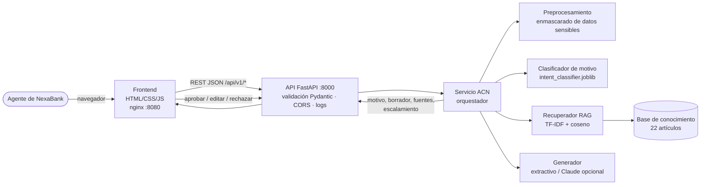

# Asistente Cognitivo NexaBank (ACN) — Fase II

Implementación técnica, integración, contenerización y preparación para despliegue del proyecto de IA
definido en la Fase I (*Business Case* del Asistente Cognitivo NexaBank).

> **NexaBank es una empresa ficticia** creada con fines académicos. La base de conocimiento y los
> datasets de este repositorio son **sintéticos** y no representan información de ninguna institución real.

| | |
|---|---|
| **Autor** | Martin Limon |
| **Materia** | Gestión de proyectos de inteligencia artificial — Maestría en IA (Tecmilenio) |
| **Versión** | 2.0.0 (Fase II), noviembre 2026 |
| **Estado** | Funcional en entorno local y en Docker; despliegue en la nube **documentado, no ejecutado** |

---

## 1. Descripción del proyecto

El ACN apoya al agente humano del centro de contacto de NexaBank. Con el mensaje del cliente:

1. **Clasifica el motivo de contacto** en 10 categorías (modelo de ML entrenado: TF-IDF + regresión logística).
2. **Recupera artículos de la base de conocimiento autorizada** (RAG: TF-IDF + similitud coseno, guiado por el motivo).
3. **Sugiere un borrador de respuesta** basado *solo* en esas fuentes, que se citan. Por defecto el modo es extractivo
   (sin internet ni costo); de forma opcional, la redacción la hace Claude si se configura `ANTHROPIC_API_KEY`.
4. **Resume el caso para el CRM**: motivo, frases clave, montos, fechas y acciones sugeridas.
5. **Aplica las reglas de gobernanza de la Fase I**: enmascara datos sensibles, escala obligatoriamente los casos de
   fraude y queja, y exige aprobación humana en cada salida. Además mide la **tasa de aceptación** de sugerencias.

## 2. Problema que resuelve

Según el *Business Case* de la Fase I, cada interacción consume 10 minutos (7 de atención y 3 de documentación manual),
lo que equivale a unos $66 M MXN anuales en el centro de contacto. La meta es reducir en **28.5 %** el tiempo por
interacción: el agente encuentra la información y documenta el caso más rápido, siempre con supervisión humana.

## 3. Arquitectura



El detalle completo está en [docs/arquitectura.md](docs/arquitectura.md).

## 4. Tecnologías utilizadas

| Capa | Tecnología | Justificación |
|---|---|---|
| Modelo | scikit-learn 1.9.1, NumPy, joblib | Ligero, reproducible y sin GPU; adecuado para texto corto en español |
| Backend / API | Python 3.13, FastAPI 0.162, Pydantic 2, Uvicorn | Validación tipada, OpenAPI/Swagger automático y alto rendimiento |
| Frontend | HTML + CSS + JavaScript (sin framework) | No requiere compilación y es fácil de mantener |
| LLM opcional | SDK `anthropic` (Claude Opus 5.5) | Redacción con fuentes restringidas y respaldo extractivo automático |
| Contenedores | Docker, Docker Compose, nginx 1.27 | Portabilidad, proxy inverso y *healthchecks* |
| Pruebas | pytest, pytest-cov, httpx, Playwright | Pruebas unitarias, funcionales, de integración y E2E en navegador |
| Nube (propuesta) | Azure Container Apps + Azure Container Registry + Key Vault | Ver [manual de despliegue](docs/manual_despliegue.md) |

## 5. Estructura del repositorio

```text
.
├── backend/app/                 # Servicio FastAPI
│   ├── main.py                  # App, middleware, manejo de errores, /health, frontend
│   ├── config.py                # Configuración por variables de entorno
│   ├── schemas.py               # Contrato de datos (Pydantic)
│   ├── api/routes.py            # Endpoints /api/v1/*
│   └── services/
│       ├── preprocessing.py     # Normalización y enmascarado (compartido con el entrenamiento)
│       ├── classifier.py        # Pipeline del clasificador y catálogo de motivos
│       ├── retriever.py         # Recuperador RAG
│       ├── generator.py         # Generación extractiva / LLM con respaldo
│       └── assistant.py         # Orquestador; carga única del modelo
├── frontend/                    # Consola del agente + Dockerfile y nginx.conf
├── data/
│   ├── knowledge_base/          # Base de conocimiento sintética (JSON)
│   ├── intents_train.csv        # Dataset sintético de entrenamiento (1,200)
│   ├── intents_test.csv         # Conjunto de prueba independiente (300)
│   └── retrieval_eval*.json     # Conjuntos de evaluación del recuperador
├── training/                    # generate_dataset.py y train.py
├── model/                       # artifacts/ (modelo, metadatos, métricas) y model card
├── tests/                       # Pruebas unitarias, API, casos extremos, validación, integración y E2E
├── scripts/                     # validate_docker.sh, make_figures.py, build_docs.py
├── docs/                        # Arquitectura, API, manual de despliegue, validación, uso de IA
├── evidencias/                  # Logs y capturas reales generados por los scripts
├── .github/workflows/ci.yml     # Integración continua (pruebas + build Docker)
├── Dockerfile                   # Imagen única (API + modelo + frontend)
├── docker-compose.yml           # Dos servicios: frontend (nginx) + api
├── requirements.txt / requirements-dev.txt
├── .env.example · .dockerignore · .gitignore
└── README.md
```

## 6. Requisitos de instalación

- Python 3.13 (probado con 3.13.16).
- Docker 24+ con Docker Compose v2 (probado con Docker 29.9.2 sobre Colima 0.10.3 en macOS).
- Opcional: una API key de Anthropic, solo si se desea el modo de generación con LLM.

## 7. Ejecución local (sin Docker)

```bash
python3 -m venv .venv
source .venv/bin/activate              # Windows: .venv\Scripts\activate
pip install -r requirements-dev.txt
cp .env.example .env                   # opcional
cd backend && uvicorn app.main:app --reload --port 8000
```

Abre <http://localhost:8000> para la consola del agente y <http://localhost:8000/docs> para Swagger.

**Reentrenar el modelo (opcional).** Los artefactos ya están versionados en `model/artifacts/`. Para regenerarlos:

```bash
python training/generate_dataset.py
PYTHONPATH=backend python training/train.py
```

## 8. Ejecución mediante Docker

**Opción A — imagen única (la misma que se despliega en la nube):**

```bash
docker build -t nexabank-acn:2.0.0 .
docker run -d --name acn -p 8000:8000 nexabank-acn:2.0.0
docker ps                                   # STATUS debe mostrar "(healthy)"
curl http://localhost:8000/health
```

**Opción B — arquitectura de dos servicios (frontend nginx + API):**

```bash
docker compose up -d --build
docker compose ps                           # ambos servicios "healthy"
# Frontend: http://localhost:8080   ·   API: http://localhost:8000/docs
docker compose down
```

**Validación automatizada con evidencias:** `bash scripts/validate_docker.sh` construye y ejecuta ambas opciones, prueba
los endpoints y corre las pruebas de integración y E2E. Los resultados se guardan en `evidencias/`.

## 9. Endpoints disponibles

| Método | Ruta | Descripción |
|---|---|---|
| GET | `/health` | Estado del servicio y del modelo (200 si está listo, 503 si está degradado) |
| POST | `/api/v1/suggest` | Motivo, borrador de respuesta, fuentes, acciones y escalamiento |
| POST | `/api/v1/classify` | Solo el motivo de contacto, con su confianza |
| POST | `/api/v1/summarize` | Resumen del caso para el CRM a partir de turnos de conversación |
| POST | `/api/v1/feedback` | Decisión del agente: `aprobada`, `editada` o `rechazada` |
| GET | `/api/v1/metrics/adoption` | KPI de tasa de aceptación de sugerencias |
| GET | `/api/v1/model/info` | Versión, métricas y configuración del modelo cargado |
| GET | `/docs` · `/openapi.json` | Documentación interactiva y especificación OpenAPI |

El contrato completo (esquemas JSON, códigos HTTP y errores) está en [docs/api.md](docs/api.md).

```bash
curl -X POST http://localhost:8000/api/v1/suggest \
  -H "Content-Type: application/json" \
  -d '{"mensaje": "No reconozco un cargo de 1,200 pesos en Amazon", "top_k": 3}'
```

## 10. Ejecución de pruebas

```bash
pytest -v                                                    # unitarias, API, casos extremos y validación del modelo
pytest --cov=backend/app --cov-report=term-missing           # con cobertura
docker compose up -d --build
ACN_BASE_URL=http://localhost:8080 pytest tests/test_integration.py -v   # contra contenedores
python -m playwright install chromium
ACN_FRONTEND_URL=http://localhost:8080 pytest tests/e2e -v               # E2E en navegador
```

**Último resultado** (`evidencias/pruebas/01_suite_completa.txt`): **100 aprobadas, 1 fallida esperada (`xfail`, una
limitación documentada) y 96 % de cobertura**. El análisis completo está en
[docs/validacion_pruebas.md](docs/validacion_pruebas.md).

| Métrica (conjunto de prueba independiente) | Valor |
|---|---|
| Accuracy del clasificador (n = 300) | 0.773 (línea base: 0.100) |
| F1 macro | 0.762 |
| Recall de casos sensibles (fraude y queja) | 0.850 |
| Recall@3 del recuperador integrado (conjunto de desarrollo / *holdout*) | 1.000 / 0.773 |

## 11. Estrategia de despliegue

La propuesta es usar **Azure Container Apps** con la imagen publicada en **Azure Container Registry**, la API key
opcional guardada como secreto y referenciada desde Key Vault, y logs en Log Analytics. El procedimiento paso a paso,
con comandos, validación, reversión y solución de problemas, está en
[docs/manual_despliegue.md](docs/manual_despliegue.md).

> **Importante:** el despliegue en la nube está **documentado y listo para ejecutarse, pero no se ejecutó** en este
> entregable. Lo que sí se ejecutó y se validó fue el despliegue local en Docker.

## 12. Consideraciones y limitaciones

- **Datos sintéticos.** Las métricas miden el desempeño sobre redacciones sintéticas. Antes de producción deben validarse
  con transcripciones reales anonimizadas, como en el piloto de 90 días recomendado en la Fase I.
- **El recuperador es léxico (TF-IDF).** Ante paráfrasis no vistas, el Recall@3 baja a 0.77. La mejora propuesta es
  usar *embeddings* semánticos multilingües.
- **Clases débiles.** `credito_prestamo` (F1 = 0.57) y `tarjeta_credito` (F1 = 0.61) se confunden entre sí y con otras
  clases. Además, 8 de 30 casos de fraude se clasificaron como aclaración de cargo (ver la matriz de confusión).
- **Estado en memoria.** El KPI de adopción y los IDs de sugerencia viven en el proceso: se pierden al reiniciar y no se
  comparten entre réplicas. En producción deben guardarse en un almacén persistente (por ejemplo Redis o una base de datos).
- **Humano en el ciclo.** El sistema no envía nada al cliente: toda salida es un borrador que el agente aprueba.
- **Sin autenticación de usuarios.** Antes de exponer el servicio fuera de una red controlada debe agregarse
  autenticación (por ejemplo, Microsoft Entra ID con *Easy Auth* de Container Apps).

## Documentación

- [Arquitectura](docs/arquitectura.md) · [Contrato de la API](docs/api.md) · [Model card](model/README.md)
- [Manual de despliegue en la nube](docs/manual_despliegue.md) · [Validación y pruebas](docs/validacion_pruebas.md)
- [Uso de herramientas de IA en el desarrollo](docs/uso_ia.md)
