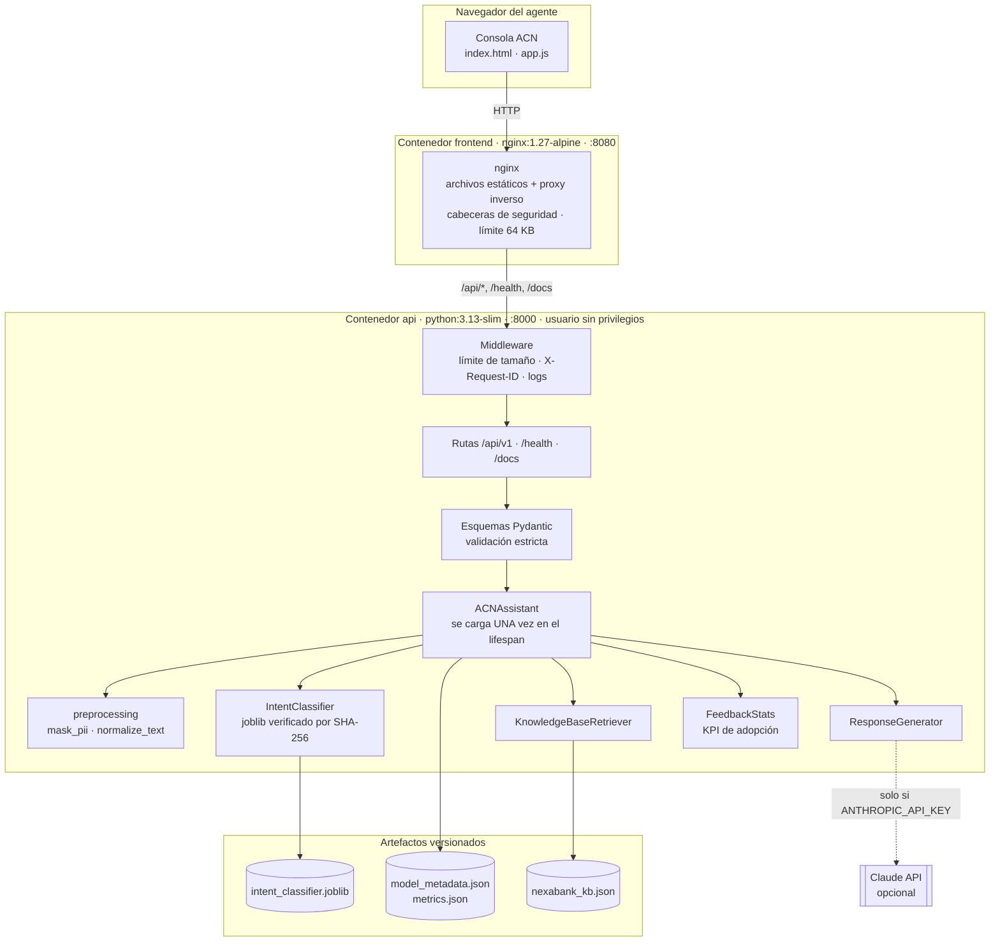
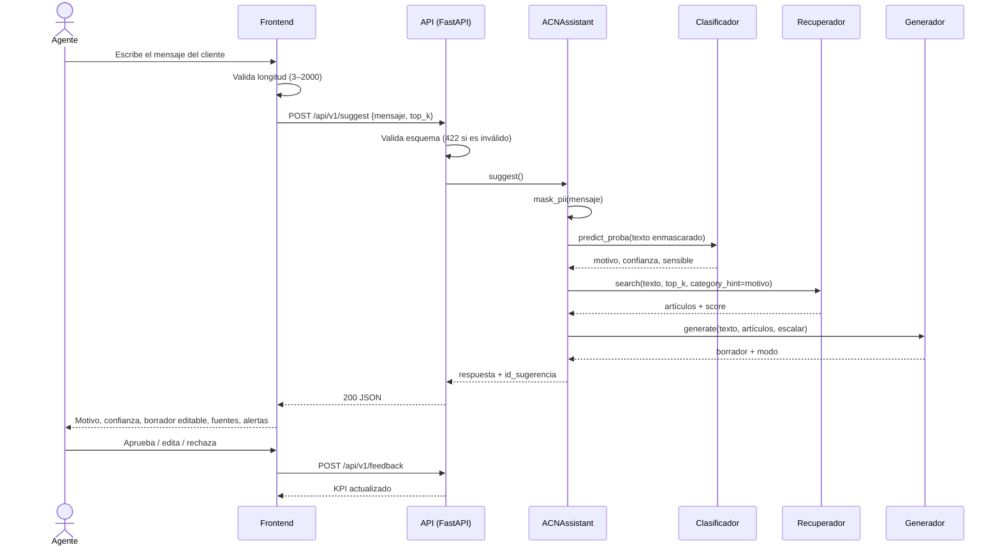

# Arquitectura técnica — Asistente Cognitivo NexaBank (Fase II)

## 1. Continuidad con la Fase I

| Elemento de la Fase I (*Business Case*) | Implementación en la Fase II |
|---|---|
| Asistente RAG que busca en la base de conocimiento autorizada y sugiere una respuesta | `retriever.py` (TF-IDF + coseno) + `generator.py` (extractivo con fuentes; LLM opcional restringido a fuentes) |
| "Genera automáticamente un resumen y clasificación del motivo de contacto para el CRM" | `classifier.py` (modelo de ML entrenado) + `POST /api/v1/summarize` |
| "No resuelve reclamaciones de fraude por sí sola" / quejas graves | Las clases sensibles activan `escalamiento_requerido=true`; la respuesta aprobada canaliza al área especializada |
| "No envía ninguna respuesta sin revisión humana" | `requiere_aprobacion_humana=true` en toda salida; la consola obliga a decidir antes de enviar |
| Anonimización de datos sensibles | `preprocessing.mask_pii()` antes de clasificar, recuperar, generar o resumir |
| KPI de tasa de aceptación (feedback del *peer review*) | `POST /api/v1/feedback` + `GET /api/v1/metrics/adoption` |
| Registro de auditoría | Log por solicitud con `X-Request-ID`, motivo, número de fuentes y modo (sin el texto del cliente) |
| Riesgo de dependencia de un proveedor (*vendor lock-in*) | El modo extractivo funciona sin LLM; el LLM es intercambiable y opcional |
| Alucinaciones | Modo por defecto 100 % extractivo; el LLM solo recibe artículos autorizados y tiene respaldo automático |

**Lo que la Fase I no incluía y se construyó en la Fase II:** el corpus de texto (base de conocimiento y dataset de
motivos, ambos sintéticos), el modelo entrenado, el backend, la API, el frontend, los contenedores y las pruebas.

## 2. Diagrama de componentes

En el despliegue en la nube se usa la **imagen única**: el mismo contenedor de la API sirve también los tres archivos
del frontend (`ACN_SERVE_FRONTEND=true`), y la infraestructura se reduce a un solo servicio.

## 3. Flujo de una sugerencia (secuencia)

## 4. Decisiones técnicas y alternativas evaluadas

| Decisión | Alternativas | Elección y justificación |
|---|---|---|
| Modelo del motivo | Reglas por palabras clave; BERT afinado; clasificación con un LLM | **TF-IDF (palabras + caracteres) + regresión logística.** Es interpretable, entrena en segundos sin GPU, la imagen queda ligera y las probabilidades sirven para calibrar el umbral. BERT exigiría GPU y un corpus real que no existe; un LLM en cada solicitud agrega costo y dependencia |
| Recuperador | *Embeddings* densos + base vectorial; BM25 | **TF-IDF + coseno.** No requiere dependencias pesadas y la base de conocimiento es pequeña (22 artículos). Limitación medida: Recall@3 de 0.77 en el *holdout*. La siguiente iteración son *embeddings* multilingües |
| Generación | Siempre LLM | **Extractiva por defecto, LLM opcional.** No alucina, cuesta cero y no depende de la red. Esto cumple el principio de la Fase I de restringirse a fuentes autorizadas |
| Framework de la API | Flask | **FastAPI.** Validación tipada, OpenAPI automático y soporte asíncrono |
| Frontend | React o Vue | **HTML/JS sin *build*.** Es la interfaz mínima, profesional y sin cadena de compilación |
| Contenedores | Una imagen vs. Compose | **Ambas.** Compose demuestra la separación frontend/backend; la imagen única simplifica la nube |
| Servidor | Gunicorn + Uvicorn workers | **Uvicorn con 1 worker por contenedor y escalamiento por réplicas** (ver hallazgo E-04 en la validación) |
| Nube | AWS, GCP, Azure | **Azure Container Apps** (ver el manual de despliegue, sección de comparación) |

## 5. Seguridad aplicada

- Sin secretos en el código: la configuración se hace por variables de entorno, `.env` está en `.gitignore` y se
  versiona `.env.example`.
- Verificación SHA-256 del modelo antes de deserializarlo (joblib/pickle puede ejecutar código).
- Contenedor con usuario sin privilegios (`uid 10001`), imagen *slim* y `.dockerignore` estricto.
- Validación estricta de entradas, límite de 64 KB y CORS restringido a orígenes configurados.
- Los errores no devuelven el texto recibido ni trazas internas; los logs no registran el texto del cliente.
- Cabeceras de seguridad en nginx (`X-Content-Type-Options`, `X-Frame-Options`, `Referrer-Policy`).
- Enmascarado de PII **antes** de cualquier procesamiento, incluido el envío opcional al LLM.
