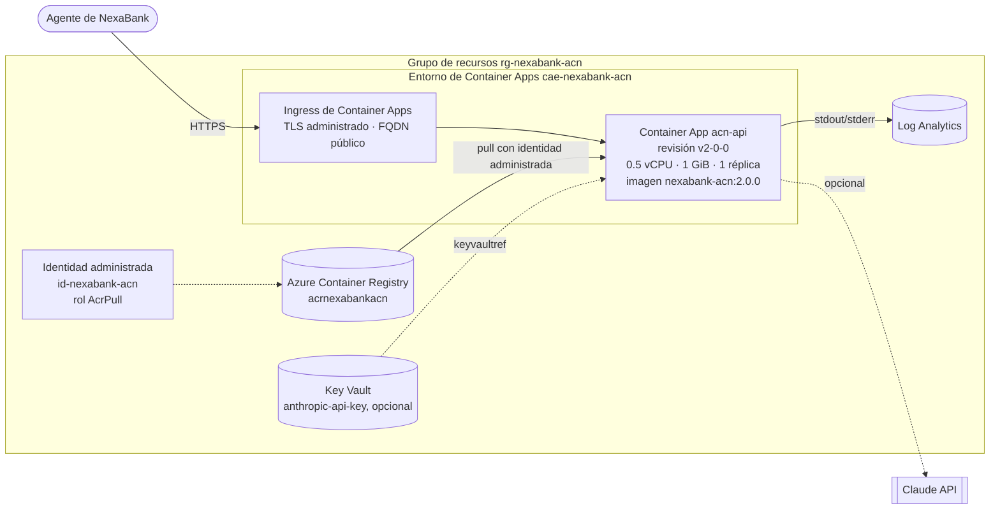

# Manual de despliegue en la nube

**Asistente Cognitivo NexaBank (ACN) — Fase II**
Maestría en Inteligencia Artificial · Gestión de proyectos de inteligencia artificial
Elaborado por: Martin Limon · Noviembre 2026 · Versión 1.0

> **Declaración de alcance.** Este manual documenta un procedimiento **preparado y verificado contra la
> documentación oficial de Microsoft**, pero **no ejecutado** en una suscripción de Azure durante este entregable. Lo que
> sí se ejecutó y se validó, con evidencia, es la construcción de la imagen y su funcionamiento en contenedores Docker en
> el entorno local (secciones 9 y 10). La aplicación **no está publicada en la nube**.

---

## 1. Introducción

El Asistente Cognitivo NexaBank (ACN) es la implementación técnica del caso de negocio de la Fase I. Es un asistente de
IA que, para cada mensaje de cliente, clasifica el motivo de contacto, recupera artículos de una base de conocimiento
autorizada (RAG), sugiere un borrador de respuesta citando sus fuentes y resume el caso para el CRM, siempre con
aprobación humana. La solución está contenerizada y se probó en local. Este manual describe cómo trasladarla a un
servicio administrado en la nube.

## 2. Objetivo

Permitir que una persona con conocimientos técnicos básicos de desarrollo despliegue, valide, opere, actualice y
revierta el ACN en **Azure Container Apps**. Para ello el manual explica:

- qué recursos y permisos se necesitan,
- qué comandos ejecutar, en qué orden y qué resultado esperar,
- cómo comprobar el funcionamiento y consultar logs,
- cómo resolver los problemas más frecuentes.

## 3. Descripción de la solución

| Componente | Descripción | Artefacto |
|---|---|---|
| Frontend | Consola web del agente (HTML/CSS/JS) | `frontend/` |
| API | FastAPI: `/health`, `/api/v1/suggest`, `/classify`, `/summarize`, `/feedback`, `/metrics/adoption`, `/model/info`, `/docs` | `backend/app/` |
| Modelo de ML | Clasificador de motivo de contacto (TF-IDF + regresión logística), verificado por SHA-256 | `model/artifacts/` |
| Recuperador RAG | TF-IDF + coseno sobre 22 artículos sintéticos | `data/knowledge_base/` |
| Generador | Extractivo (por defecto) o Claude (opcional, si hay `ANTHROPIC_API_KEY`) | `services/generator.py` |
| Imagen Docker | `python:3.13-slim`, usuario sin privilegios, `HEALTHCHECK`, puerto `8000` (configurable con `PORT`) | `Dockerfile` |

## 4. Selección de la plataforma cloud

### 4.1 Alternativas evaluadas

| Criterio | **Azure Container Apps** | Google Cloud Run | AWS ECS Fargate | PaaS (Render/Railway) |
|---|---|---|---|---|
| Compatibilidad con Docker | Nativa (cualquier imagen OCI) | Nativa | Nativa | Nativa |
| Facilidad de implementación | Alta: `az containerapp create` con ingress HTTPS incluido | Alta: `gcloud run deploy` | Media: requiere task definition, cluster, ALB y VPC | Muy alta |
| Infraestructura que se administra | Ninguna (serverless) | Ninguna | Red y balanceador | Ninguna |
| CPU / memoria requeridas (0.5 vCPU, 1 GiB) | Sí | Sí | Sí | Sí, planes limitados |
| GPU | No se necesita | No se necesita | No se necesita | No se necesita |
| Escalabilidad | Réplicas automáticas (KEDA), escala a cero | Automática, escala a cero | Auto Scaling de servicios | Limitada |
| Seguridad / secretos | Secretos + referencias a Key Vault, identidad administrada, Entra ID | Secret Manager, IAM | Secrets Manager, IAM | Variables de entorno |
| Versiones y reversión | **Revisiones inmutables**, división de tráfico | Revisiones, división de tráfico | Despliegues *rolling* | Básico |
| Logs | Log Analytics integrado | Cloud Logging | CloudWatch | Básico |
| Costo para el piloto | Concesión mensual gratuita por suscripción: 180,000 vCPU-s, 360,000 GiB-s y 2 M de solicitudes | Nivel gratuito comparable | Sin nivel gratuito para Fargate | Planes de pago para servicio continuo |
| Contexto bancario | Cumplimiento empresarial, integración con Entra ID / M365 frecuente en banca mexicana | Bueno | Bueno | No apto para un banco |

### 4.2 Decisión

**Estrategia principal: Azure Container Apps (plan Consumption) + Azure Container Registry + Key Vault + Log Analytics.**

Justificación técnica:

1. **Despliegue directo de la imagen ya validada.** Container Apps ejecuta la misma imagen que pasó las pruebas en local,
   sin cambios. Solo necesita apuntar a `--target-port 8000`.
2. **Revisiones inmutables.** Cada versión es una revisión: la reversión es inmediata y existe división de tráfico
   (*blue/green*), lo que responde a la estrategia de piloto controlado de la Fase I.
3. **Seguridad.** La identidad administrada extrae la imagen sin contraseñas de administrador y la API key opcional se
   referencia desde Key Vault. Se puede activar autenticación con Microsoft Entra ID sin modificar el código.
4. **Costo.** El servicio es ligero (0.5 vCPU, 1 GiB, sin GPU). Con una réplica mínima, el consumo del piloto se acerca
   a la concesión gratuita mensual. Fuera de ella se paga por segundo de uso. El costo debe estimarse con la
   [calculadora oficial](https://azure.microsoft.com/pricing/details/container-apps/).
5. **Alternativa equivalente.** Google Cloud Run (`gcloud run deploy --image ... --port 8000`) es igualmente viable y
   tiene un costo similar. Se documenta como plan B en el anexo A.

## 5. Arquitectura de despliegue



## 6. Requerimientos de hardware y software

| Elemento | Requerimiento |
|---|---|
| Equipo del operador | Windows, macOS o Linux con conexión a internet |
| Azure CLI | 2.60 o superior, con la extensión `containerapp` |
| Docker | Opcional. Con `az acr build` la imagen se construye en Azure. Si se usa Docker local en Mac con Apple Silicon, debe agregarse `--platform linux/amd64` |
| Git | Para clonar el repositorio |
| Python 3.13 | Opcional, para ejecutar las pruebas de integración contra la URL publicada |
| Recursos de la app | 0.5 vCPU, 1.0 GiB de RAM, sin GPU. Arranque medido en local: contenedor *healthy* en menos de 10 s |

## 7. Cuentas y servicios necesarios

| Servicio | Uso | Permiso mínimo |
|---|---|---|
| Suscripción de Azure (o Azure for Students) | Contenedor de todos los recursos | *Contributor* + *User Access Administrator* (para asignar `AcrPull`), o *Owner* |
| Azure Container Registry (SKU Basic) | Almacenar la imagen | Lo crea el script |
| Azure Container Apps + entorno | Ejecutar el contenedor con HTTPS | Lo crea el script |
| Log Analytics | Logs | Se crea con el entorno |
| Azure Key Vault | Guardar `ANTHROPIC_API_KEY` (solo si se usa el modo LLM) | *Key Vault Secrets Officer* para crear el secreto |
| GitHub | Código fuente | Lectura del repositorio |
| Anthropic (opcional) | API key para generación con Claude | — |

## 8. Configuración del entorno

### 8.1 Instalar y preparar la Azure CLI

```bash
# macOS: brew install azure-cli    ·    Windows: winget install -e --id Microsoft.AzureCLI
az login                                   # abre el navegador para iniciar sesión
az account show --output table             # confirma la suscripción activa
az extension add --name containerapp --upgrade
az provider register --namespace Microsoft.App
az provider register --namespace Microsoft.OperationalInsights
```

Verifica que la región elegida ofrezca Container Apps:

```bash
az provider show --namespace Microsoft.App \
  --query "resourceTypes[?resourceType=='managedEnvironments'].locations" --output tsv
```

Para cumplir con la residencia de datos de un banco mexicano conviene **Mexico Central** si aparece en la lista. Si no,
la alternativa más cercana es `southcentralus` o `eastus`.

### 8.2 Obtener el código

```bash
git clone https://github.com/marlim21/nexabank-acn-fase2.git
cd nexabank-acn-fase2
```

### 8.3 Definir variables de shell

```bash
RESOURCE_GROUP="rg-nexabank-acn"
LOCATION="eastus"
ENVIRONMENT="cae-nexabank-acn"
APP_NAME="acn-api"
ACR_NAME="acrnexabankacn$RANDOM"          # único a nivel global: solo minúsculas y números
IDENTITY="id-nexabank-acn"
IMAGE_TAG="2.0.0"
IMAGE="$ACR_NAME.azurecr.io/nexabank-acn:$IMAGE_TAG"
```

## 9. Construcción del contenedor Docker

La imagen se define en el `Dockerfile` de la raíz:

| Instrucción | Propósito |
|---|---|
| `FROM python:3.13-slim` | Imagen base ligera, con la misma versión de Python con la que se entrenó el modelo |
| `COPY requirements.txt` + `pip install` | Dependencias en una capa propia, para aprovechar la caché |
| `COPY backend/ model/artifacts/ data/knowledge_base/ frontend/` | Solo los archivos necesarios en ejecución (`.dockerignore` excluye pruebas, datasets, `.env` y `.git`) |
| `useradd ... && USER acn` | Ejecución sin privilegios de root |
| `EXPOSE 8000` + `HEALTHCHECK` | Puerto y verificación de salud contra `/health` |
| `CMD uvicorn ... --port ${PORT}` | Puerto configurable, como lo requieren los servicios cloud |

**Construcción local (ejecutada; evidencia en `evidencias/docker/01_docker_build.log`):**

```bash
docker build -t nexabank-acn:2.0.0 .
docker image ls nexabank-acn:2.0.0
# IMAGE                ID             DISK USAGE   CONTENT SIZE
# nexabank-acn:2.0.0   a7b89ce22260        669MB          140MB
```

## 10. Ejecución local (validación previa al despliegue)

Antes de publicar cualquier versión, debe validarse en local. Este proceso **se ejecutó** con los resultados siguientes:

```bash
docker run -d --name acn -p 8000:8000 nexabank-acn:2.0.0
docker ps        # acn-single   nexabank-acn:2.0.0   Up 6 seconds (healthy)   0.0.0.0:8000->8000/tcp
curl http://localhost:8000/health
# {"status":"ok","modelo_cargado":true,"version":"2.0.0","entorno":"docker","modo_generacion":"extractivo","detalle":null}
ACN_BASE_URL=http://localhost:8000 pytest tests/test_integration.py -v      # 7 passed
docker rm -f acn
```

Con la arquitectura de dos servicios (`docker compose up -d --build`), los contenedores `acn-api` y `acn-frontend`
quedaron *healthy*. Pasaron 7/7 pruebas de integración a través del proxy nginx y 7/7 pruebas E2E en navegador. El
script completo es `scripts/validate_docker.sh`.

## 11. Configuración del servicio cloud

### 11.1 Grupo de recursos y registro de contenedores

```bash
az group create --name $RESOURCE_GROUP --location $LOCATION
az acr create --resource-group $RESOURCE_GROUP --location $LOCATION --name $ACR_NAME --sku Basic
az acr config authentication-as-arm update --registry $ACR_NAME --status enabled
```

### 11.2 Identidad administrada (sin credenciales de administrador del registro)

```bash
az identity create --name $IDENTITY --resource-group $RESOURCE_GROUP
IDENTITY_ID=$(az identity show --name $IDENTITY --resource-group $RESOURCE_GROUP --query id --output tsv)
```

### 11.3 Publicar la imagen en el registro

**Opción A (recomendada): construir en Azure.** No requiere Docker local y produce una imagen `linux/amd64`.

```bash
az acr build --registry $ACR_NAME --image nexabank-acn:$IMAGE_TAG .
```

**Opción B: construir en local y hacer *push*.**

```bash
docker build --platform linux/amd64 -t $IMAGE .
az acr login --name $ACR_NAME
docker push $IMAGE
az acr repository show-tags --name $ACR_NAME --repository nexabank-acn --output table
```

### 11.4 Entorno de Container Apps

```bash
az containerapp env create --name $ENVIRONMENT --resource-group $RESOURCE_GROUP --location $LOCATION
```

El entorno crea automáticamente un espacio de trabajo de Log Analytics para los logs.

## 12. Procedimiento de despliegue

```bash
az containerapp create \
  --name $APP_NAME \
  --resource-group $RESOURCE_GROUP \
  --environment $ENVIRONMENT \
  --image $IMAGE \
  --target-port 8000 \
  --ingress external \
  --registry-server $ACR_NAME.azurecr.io \
  --user-assigned "$IDENTITY_ID" \
  --registry-identity "$IDENTITY_ID" \
  --cpu 0.5 --memory 1.0Gi \
  --min-replicas 1 --max-replicas 1 \
  --revision-suffix v2-0-0 \
  --env-vars ACN_ENV=azure ACN_LOG_LEVEL=INFO ACN_SERVE_FRONTEND=true ACN_WORKERS=1 \
  --query properties.configuration.ingress.fqdn --output tsv
```

**Puertos y conectividad:**

- `--target-port 8000` corresponde al puerto en el que escucha Uvicorn dentro del contenedor.
- `--ingress external` publica la app en internet con un FQDN `https://acn-api.<id>.<región>.azurecontainerapps.io`
  y certificado TLS administrado. Para un uso solo interno del banco, usa `--ingress internal` con un entorno integrado
  a una VNet.
- `--min-replicas 1 --max-replicas 1`: el KPI de adopción y los IDs de sugerencia viven en memoria (limitación
  documentada). Para escalar horizontalmente, primero debe moverse ese estado a Redis o a una base de datos.

Todo el procedimiento está automatizado en `deploy/azure/deploy_azure.sh`.

## 13. Configuración de variables de entorno y secretos

| Variable | Valor en Azure | Tipo |
|---|---|---|
| `ACN_ENV` | `azure` | Variable de entorno |
| `ACN_LOG_LEVEL` | `INFO` | Variable de entorno |
| `ACN_SERVE_FRONTEND` | `true` (la imagen única sirve la consola) | Variable de entorno |
| `ACN_WORKERS` | `1` | Variable de entorno |
| `ACN_CORS_ORIGINS` | `https://<FQDN>` | Variable de entorno |
| `ANTHROPIC_API_KEY` | Referencia a Key Vault | **Secreto** (solo si se usa el modo LLM) |

**Actualizar CORS con el dominio público:**

```bash
FQDN=$(az containerapp show -n $APP_NAME -g $RESOURCE_GROUP --query properties.configuration.ingress.fqdn -o tsv)
az containerapp update -n $APP_NAME -g $RESOURCE_GROUP --set-env-vars "ACN_CORS_ORIGINS=https://$FQDN"
```

**Secreto opcional para el modo LLM.** Nunca escribas la clave en el código ni en GitHub.

```bash
# 1) Crear Key Vault con RBAC y guardar el secreto (la clave se lee de la terminal, no queda en el historial)
az keyvault create -n kv-nexabank-acn -g $RESOURCE_GROUP -l $LOCATION --enable-rbac-authorization true
read -s ANTHROPIC_KEY && az keyvault secret set --vault-name kv-nexabank-acn -n anthropic-api-key --value "$ANTHROPIC_KEY"

# 2) Permitir que la identidad administrada lea secretos
PRINCIPAL_ID=$(az identity show -n $IDENTITY -g $RESOURCE_GROUP --query principalId -o tsv)
KV_ID=$(az keyvault show -n kv-nexabank-acn --query id -o tsv)
az role assignment create --assignee $PRINCIPAL_ID --role "Key Vault Secrets User" --scope $KV_ID

# 3) Registrar el secreto en la app como referencia a Key Vault y exponerlo como variable de entorno
SECRET_URI=$(az keyvault secret show --vault-name kv-nexabank-acn -n anthropic-api-key --query id -o tsv | sed 's#/[^/]*$##')
az containerapp secret set -n $APP_NAME -g $RESOURCE_GROUP \
  --secrets "anthropic-api-key=keyvaultref:$SECRET_URI,identityref:$IDENTITY_ID"
az containerapp update -n $APP_NAME -g $RESOURCE_GROUP \
  --set-env-vars "ANTHROPIC_API_KEY=secretref:anthropic-api-key"
```

Si se omite el secreto, el servicio funciona en modo extractivo sin ninguna dependencia externa.

## 14. Validación del servicio desplegado

### 14.1 Inicio de la aplicación

```bash
az containerapp revision list -n $APP_NAME -g $RESOURCE_GROUP \
  --query "[].{revision:name, activa:properties.active, estado:properties.runningState, salud:properties.healthState}" -o table
```

Resultado esperado: una revisión `acn-api--v2-0-0` con `activa=True`, `estado=Running` y `salud=Healthy`.

### 14.2 Validación de endpoints

```bash
curl -i https://$FQDN/health
#  HTTP/2 200 · {"status":"ok","modelo_cargado":true,...,"entorno":"azure"}

curl -s -X POST https://$FQDN/api/v1/suggest -H "Content-Type: application/json" \
  -d '{"mensaje":"Me robaron la tarjeta de débito","top_k":3}'
#  motivo.intent = "bloqueo_tarjeta", fuentes[0].id = "KB-005", requiere_aprobacion_humana = true

curl -s -o /dev/null -w "%{http_code}\n" -X POST https://$FQDN/api/v1/suggest \
  -H "Content-Type: application/json" -d '{"mensaje":""}'
#  422
```

### 14.3 Verificación funcional completa

```bash
ACN_BASE_URL=https://$FQDN pytest tests/test_integration.py -v           # se esperan 7 passed
ACN_FRONTEND_URL=https://$FQDN pytest tests/e2e -v                       # E2E en navegador contra la nube
```

Por último, abre `https://$FQDN` en el navegador, prueba un ejemplo y verifica que aparezcan el motivo, el borrador,
las fuentes y los botones de aprobación. Abre también `https://$FQDN/docs`.

### 14.4 Consulta de logs

```bash
az containerapp logs show -n $APP_NAME -g $RESOURCE_GROUP --follow --tail 50          # logs de la aplicación
az containerapp logs show -n $APP_NAME -g $RESOURCE_GROUP --type system --tail 50     # eventos de la plataforma
```

Cada línea de log incluye `req=<X-Request-ID>`, el método, la ruta, el código y la latencia. También se puede consultar
desde Log Analytics con KQL:

```kusto
ContainerAppConsoleLogs_CL
| where ContainerAppName_s == "acn-api" and Log_s has "suggest intent="
| project TimeGenerated, Log_s
| order by TimeGenerated desc
```

## 15. Seguridad y mantenimiento

### 15.1 Estrategia de actualización

```bash
IMAGE_TAG=2.1.0
az acr build --registry $ACR_NAME --image nexabank-acn:$IMAGE_TAG .
az containerapp update -n $APP_NAME -g $RESOURCE_GROUP \
  --image $ACR_NAME.azurecr.io/nexabank-acn:$IMAGE_TAG --revision-suffix v2-1-0
```

En modo de revisión única, Container Apps solo mueve el tráfico cuando la nueva revisión está lista, sin tiempo de
inactividad. Para un despliegue gradual (*canary*), usa el modo múltiple:

```bash
az containerapp revision set-mode -n $APP_NAME -g $RESOURCE_GROUP --mode multiple
az containerapp ingress traffic set -n $APP_NAME -g $RESOURCE_GROUP \
  --revision-weight acn-api--v2-0-0=80 acn-api--v2-1-0=20
```

### 15.2 Reversión de versiones (*rollback*)

```bash
az containerapp revision list -n $APP_NAME -g $RESOURCE_GROUP -o table
az containerapp revision activate -n $APP_NAME -g $RESOURCE_GROUP --revision acn-api--v2-0-0
az containerapp ingress traffic set -n $APP_NAME -g $RESOURCE_GROUP --revision-weight acn-api--v2-0-0=100
az containerapp revision deactivate -n $APP_NAME -g $RESOURCE_GROUP --revision acn-api--v2-1-0
```

Las imágenes se etiquetan con su versión semántica (`2.0.0`, `2.1.0`, …) y nunca se sobrescriben. Así, cualquier
revisión anterior se puede reconstruir exactamente.

### 15.3 Seguridad

- **Secretos:** solo en Key Vault o como secretos de Container Apps; nunca en el código, la imagen o GitHub
  (`.env` está en `.gitignore` y `.dockerignore`).
- **Acceso a la imagen:** identidad administrada con rol `AcrPull`; el usuario administrador del registro permanece
  deshabilitado.
- **Autenticación de usuarios** (pendiente antes del piloto real): activar la autenticación integrada con Microsoft
  Entra ID (`az containerapp auth microsoft update ...`) o publicar con `--ingress internal` dentro de la VNet del banco.
- **Contenedor endurecido:** usuario no root, imagen *slim*, verificación SHA-256 del modelo, límite de 64 KB por
  solicitud y validación estricta.
- **Datos personales:** enmascarado de tarjeta, CLABE, correo, teléfono y NIP antes de procesar; los logs no registran
  el texto del cliente (alineado con la LFPDPPP mencionada en la Fase I).
- **Vulnerabilidades:** reconstruir mensualmente para incorporar parches de `python:3.13-slim` y revisar dependencias
  (por ejemplo con `pip-audit`).

### 15.4 Mantenimiento del modelo

| Actividad | Frecuencia | Responsable (Fase I) |
|---|---|---|
| Actualizar la base de conocimiento (`nexabank_kb.json`) y redesplegar | Trimestral o ante cambios de política | Producto / Conocimiento |
| Reentrenar con transcripciones reales anonimizadas y comparar métricas contra `metrics.json` | Después del piloto, luego trimestral | Equipo de IA |
| Revisar la tasa de aceptación (`/api/v1/metrics/adoption`) y una muestra de sugerencias | Mensual | Comité de Gobernanza de IA |
| Revisar costos en Cost Management | Mensual | TI |

## 16. Solución de problemas

| Síntoma | Causa probable | Solución |
|---|---|---|
| La revisión queda en `Activation failed` o `exec format error` en los logs | Imagen construida en Mac con Apple Silicon (arm64) | Usar `az acr build` o `docker build --platform linux/amd64` |
| `UNAUTHORIZED` o `ImagePullBackOff` al crear la app | La identidad no tiene `AcrPull` o no se habilitó la autenticación ARM | `az acr config authentication-as-arm update --status enabled` y repetir `--registry-identity` |
| `/health` responde 503 con `"modelo_cargado": false` | Faltan artefactos, el hash no coincide o la base de conocimiento no existe | Revisar `detalle` en `/health` y los logs (`No se pudo cargar el modelo: ...`); reconstruir desde un commit etiquetado |
| La app no responde y `Running` sigue sin ingress | `--target-port` no coincide con `PORT` | Usar `--target-port 8000` o definir `PORT` igual al puerto de ingress |
| El navegador muestra un error de CORS | `ACN_CORS_ORIGINS` no incluye el dominio | Actualizar la variable con `https://$FQDN` |
| `POST /api/v1/feedback` devuelve 404 de forma intermitente | Varias réplicas o workers con estado en memoria | Mantener `--max-replicas 1` y `ACN_WORKERS=1`, o mover el estado a Redis |
| El modo de generación sigue siendo `extractivo` aunque se configuró la API key | El secreto no se resolvió o falta el rol de Key Vault | Verificar `az containerapp secret list` y el rol *Key Vault Secrets User*; reiniciar la revisión |
| Advertencia `Modelo entrenado con scikit-learn X y servido con Y` | La versión de las dependencias no coincide | Reinstalar con `requirements.txt` fijado y reconstruir |
| `MissingSubscriptionRegistration` | Faltan proveedores registrados | `az provider register --namespace Microsoft.App` (y `Microsoft.OperationalInsights`) |

**Limpieza de recursos** (para evitar costos al terminar la evaluación):

```bash
az group delete --name $RESOURCE_GROUP --yes --no-wait
```

## 17. Conclusiones

- La solución está lista para la nube: la imagen es portable, el puerto es configurable, expone `/health` para las
  sondas, no guarda secretos en el código y registra logs con identificador de solicitud.
- Azure Container Apps permite desplegar la misma imagen validada en local en unos minutos, con HTTPS, revisiones
  inmutables para reversión inmediata, secretos en Key Vault y logs centralizados.
- Antes de un piloto con datos reales hay dos tareas pendientes: (1) autenticación de usuarios con Entra ID y
  (2) persistencia del KPI de adopción. Ambas están identificadas en este manual.
- **Estado actual:** el procedimiento está documentado y alineado con la documentación oficial vigente; el despliegue
  en Azure **no se ejecutó**.

## 18. Referencias bibliográficas

Docker Inc. (2026). *Dockerfile reference*. https://docs.docker.com/reference/dockerfile/

Docker Inc. (2026). *Docker Compose file reference*. https://docs.docker.com/reference/compose-file/

FastAPI. (2026). *FastAPI documentation: Deployment — FastAPI in containers*. https://fastapi.tiangolo.com/deployment/docker/

Microsoft. (2025). *Tutorial: Build and deploy your app to Azure Container Apps*. Microsoft Learn. https://learn.microsoft.com/en-us/azure/container-apps/tutorial-code-to-cloud

Microsoft. (2025). *Billing in Azure Container Apps*. Microsoft Learn. https://learn.microsoft.com/en-us/azure/container-apps/billing

Microsoft. (2025). *Health probes in Azure Container Apps*. Microsoft Learn. https://learn.microsoft.com/en-us/azure/container-apps/health-probes

Microsoft. (2025). *Update and deploy changes in Azure Container Apps (revisions)*. Microsoft Learn. https://learn.microsoft.com/en-us/azure/container-apps/revisions

Microsoft. (2026). *Manage secrets in Azure Container Apps*. Microsoft Learn. https://learn.microsoft.com/en-us/azure/container-apps/manage-secrets

Microsoft. (2026). *az containerapp* (Azure CLI reference). https://learn.microsoft.com/en-us/cli/azure/containerapp

Limon, M. (2026). *Asistente Cognitivo NexaBank (ACN): Business Case — Proyecto de inteligencia artificial, Fase 1* [Documento académico]. Universidad Tecmilenio.

---

## Anexo A. Plan B: Google Cloud Run

```bash
gcloud auth login && gcloud config set project <PROJECT_ID>
gcloud services enable run.googleapis.com artifactregistry.googleapis.com cloudbuild.googleapis.com
gcloud artifacts repositories create acn --repository-format=docker --location=us-central1
gcloud builds submit --tag us-central1-docker.pkg.dev/<PROJECT_ID>/acn/nexabank-acn:2.0.0 .
gcloud run deploy acn-api --image us-central1-docker.pkg.dev/<PROJECT_ID>/acn/nexabank-acn:2.0.0 \
  --region us-central1 --port 8000 --cpu 1 --memory 1Gi --min-instances 1 --max-instances 1 \
  --set-env-vars ACN_ENV=gcp,ACN_SERVE_FRONTEND=true --allow-unauthenticated
```

## Anexo B. Integración continua

El workflow `.github/workflows/ci.yml` ejecuta en cada *push* las pruebas (unitarias, API, casos extremos y validación del
modelo), construye la imagen Docker, la levanta y corre las pruebas de integración contra el contenedor. Es la base para
agregar después un *job* de publicación en ACR y `az containerapp update`.
