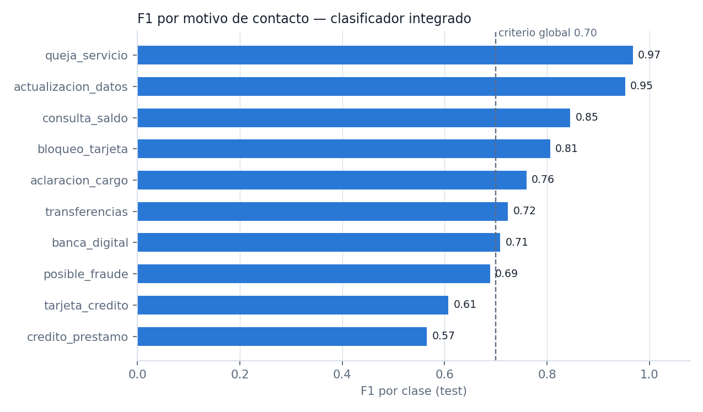
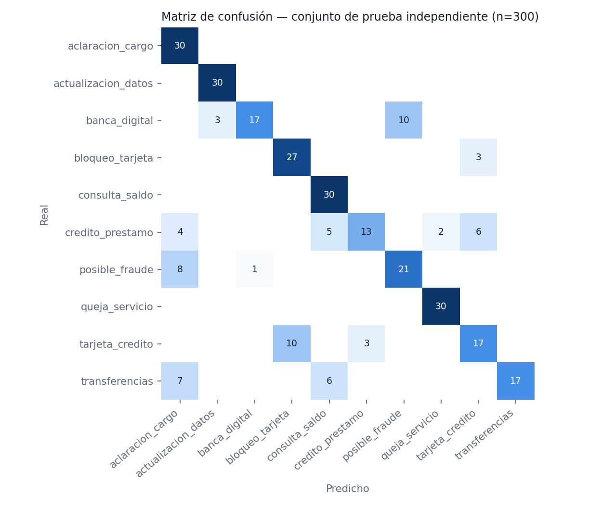
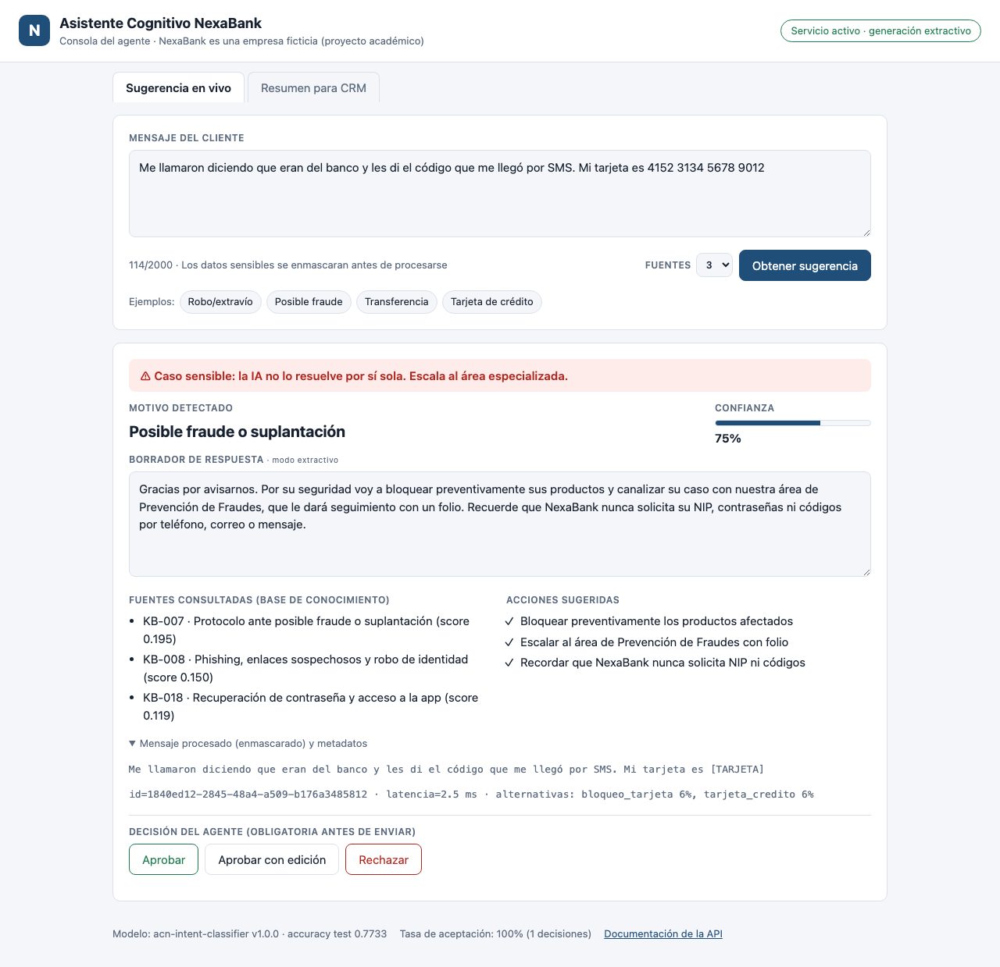

# Documento de validación y pruebas

**Asistente Cognitivo NexaBank (ACN) — Fase II**
Maestría en Inteligencia Artificial · Gestión de proyectos de inteligencia artificial
Elaborado por: Martin Limon · Noviembre 2026 · Versión 1.0

> Todos los resultados de este documento provienen de **ejecuciones reales**. Cada tabla indica el archivo de evidencia
> correspondiente en `evidencias/` y se puede reproducir con los comandos de la sección 6.

---

## 1. Introducción

Este documento formaliza la validación técnica del ACN: el modelo de clasificación del motivo de contacto, el
recuperador RAG, el generador de respuestas, la API REST, la consola web y su ejecución en contenedores Docker. También
registra los defectos encontrados durante las pruebas, las correcciones aplicadas y las limitaciones que siguen abiertas.

## 2. Objetivo de las pruebas

1. Verificar que cada componente funciona de forma aislada (pruebas unitarias).
2. Verificar la comunicación frontend → API → modelo → respuesta, en local y dentro de contenedores (integración y E2E).
3. Verificar que la API cumple su contrato: solicitudes válidas, validación de campos y códigos de error (pruebas
   funcionales).
4. Comprobar que el sistema es robusto ante entradas inválidas, atípicas o maliciosas y ante fallas de sus componentes
   (casos extremos).
5. Validar que el modelo integrado **conserva el desempeño medido en el entrenamiento** y cumple los criterios de
   aceptación definidos antes de la integración.
6. Verificar los controles de gobernanza de la Fase I: enmascarado de datos sensibles, escalamiento de casos sensibles
   y aprobación humana.

## 3. Descripción del modelo

| Aspecto | Detalle |
|---|---|
| Problema | Clasificación de texto multiclase (10 motivos de contacto) + recuperación de información (RAG) |
| Clasificador | `FeatureUnion(TF-IDF palabras 1–2 + TF-IDF caracteres 3–5)` → `LogisticRegression(C=0.5, class_weight="balanced")` |
| Recuperador | TF-IDF (título ×2 + palabras clave + contenido) + similitud coseno + refuerzo de +0.10 a la categoría predicha |
| Generador | Extractivo con la respuesta aprobada del artículo principal (por defecto); Claude opcional con respaldo |
| Datos | Sintéticos. Entrenamiento: 1,200 ejemplos (18 frases núcleo por clase). Prueba: 300 ejemplos (4 frases núcleo por clase **nunca vistas**) |
| Artefacto | `model/artifacts/intent_classifier.joblib` (SHA-256 verificado al cargar), scikit-learn 1.9.1 |

**Continuidad con la Fase I.** La Fase I fue un *business case*: no entregó un modelo entrenado, un dataset ni
métricas de ML. Por eso la comparación "antes / después de la integración" que se presenta aquí se hace entre las
**métricas del entrenamiento** (`metrics.json`) y las **métricas reproducidas a través de la API y de los contenedores**.

## 4. Entorno de ejecución

| Elemento | Versión / detalle |
|---|---|
| Equipo | macOS (Apple Silicon), Darwin 27.0 |
| Python | 3.13.16 (local) y `python:3.13-slim` (contenedor) |
| Bibliotecas | FastAPI 0.162.0, Pydantic 2.14.2, scikit-learn 1.9.1, NumPy 2.5.4, Uvicorn 0.54.0 |
| Pruebas | pytest 9.2.0, pytest-cov 7.0.0, httpx 0.28.1, Playwright 1.55.0 (Chromium headless) |
| Contenedores | Docker 29.9.2 sobre Colima 0.10.3; Docker Compose 5.6.1; nginx 1.27-alpine |
| Configuraciones probadas | (a) proceso local con `TestClient`; (b) imagen única `nexabank-acn:2.0.0` en `:8000`; (c) Compose: `acn-frontend` (`:8080`) + `acn-api` (`:8000`) |

## 5. Metodología de pruebas

- **Pirámide de pruebas:** muchas pruebas unitarias rápidas, pruebas funcionales de la API con `TestClient`, y pruebas
  de integración y E2E contra los contenedores en ejecución.
- **Criterios de aceptación definidos antes de integrar:**

| Criterio | Umbral | Justificación |
|---|---|---|
| Accuracy del clasificador en test | ≥ 0.70 | Mínimo útil para el agente, con revisión humana |
| F1 macro en test | ≥ 0.70 | Evita que clases minoritarias queden desatendidas |
| Recall de clases sensibles (fraude + queja) | ≥ 0.80 | Prioridad de la gobernanza de la Fase I: no dejar pasar fraude ni quejas |
| Recall@3 del recuperador integrado | ≥ 0.90 | El artículo correcto debe estar entre las 3 fuentes mostradas |
| Latencia p95 de `/suggest` | < 250 ms | Asistencia en tiempo real durante la llamada |
| Métricas a través de la API = métricas de entrenamiento | Δ ≤ 0.0001 | Sin inconsistencias entre entrenamiento e inferencia |

- **Sin fuga de información:** la selección de hiperparámetros y del umbral usa solo el entrenamiento (CV agrupada y
  predicciones *out-of-fold*). El conjunto de prueba se usa únicamente para la evaluación final.
- **Clasificación de resultados:** APROBADO, FALLIDO o PENDIENTE.

## 6. Cómo reproducir

```bash
pip install -r requirements-dev.txt && python -m playwright install chromium
pytest -v --cov=backend/app                         # 1) unitarias, funcionales, casos extremos y validación
bash scripts/validate_docker.sh                     # 2) build + run + endpoints + integración + E2E en Docker
```

| Evidencia | Archivo |
|---|---|
| Suite completa con cobertura (local + contenedores) | `evidencias/pruebas/01_suite_completa.txt`, `junit_resultados.xml` |
| Integración, imagen única | `evidencias/pruebas/02_integracion_imagen_unica.txt` |
| Integración vía nginx (Compose) | `evidencias/pruebas/03_integracion_compose_via_frontend.txt` |
| E2E en navegador | `evidencias/pruebas/04_e2e_navegador.txt` + capturas en `evidencias/frontend_backend/` |
| Latencia en contenedores | `evidencias/pruebas/05_latencia_contenedores.txt` |
| Falla detectada (multi-worker) | `evidencias/pruebas/00_hallazgo_falla_feedback_multiworker.txt` |

## 7. Pruebas unitarias

`tests/test_preprocessing.py` (12) y `tests/test_model.py` (22): **34 de 34 aprobadas.**

| ID | Escenario | Resultado esperado | Resultado obtenido | Estado |
|---|---|---|---|---|
| U-01 | Quitar acentos conservando la ñ | "Contraseña olvide AEIOU" | Igual | APROBADO |
| U-02 | Normalizar texto (minúsculas, sin signos) y manejar texto vacío o `None` | Cadena limpia o vacía, sin excepción | Igual | APROBADO |
| U-03 | Enmascarar tarjeta (con y sin espacios), CLABE, correo, teléfono y NIP (6 casos) | Marcador presente y **cero dígitos** restantes | 6/6 | APROBADO |
| U-04 | El enmascarado no altera montos | "1,200 pesos" intacto | Igual | APROBADO |
| U-05 | Extraer montos y fechas | `1,200`, `$350`, `3 de octubre`, `ayer` | Igual | APROBADO |
| U-06 | Dividir en oraciones | 3 oraciones | 3 | APROBADO |
| U-07 | Los artefactos existen y el SHA-256 coincide con los metadatos | Hash igual; 10 clases | Igual | APROBADO |
| U-08 | Carga del modelo: 10 clases y umbral calibrado de 0.30 | Igual | Igual | APROBADO |
| U-09 | Predicción de un caso canónico por cada clase (10 casos) | La clase correcta | 10/10 | APROBADO |
| U-10 | Las probabilidades suman 1 y están en [0, 1] | Sí | Sí | APROBADO |
| U-11 | Un caso de fraude se marca como sensible | `sensitive=True` | Igual | APROBADO |
| U-12 | El recuperador devuelve KB-005 para "Me robaron la tarjeta"; scores en orden descendente | KB-005 primero | Igual | APROBADO |
| U-13 | La pista de categoría prioriza la clase predicha | Categoría `bloqueo_tarjeta` | Igual | APROBADO |
| U-14 | Consulta sin coincidencias | Lista vacía | Vacía | APROBADO |
| U-15 | El modo extractivo usa la respuesta aprobada del artículo | Texto contenido | Sí | APROBADO |
| U-16 | Sin fuentes → respuesta de "no hay información suficiente" | `NO_CONTEXT_REPLY` | Igual | APROBADO |
| U-17 | El LLM falla por la red → respaldo extractivo | `modo=extractivo_fallback` | Igual | APROBADO |
| U-18 | El LLM (cliente simulado) recibe solo las fuentes recuperadas y el texto enmascarado, con el modelo `claude-opus-5-5` | Título del artículo y `[TARJETA]` en el prompt | Igual | APROBADO |
| U-19 | El LLM rechaza la solicitud (`stop_reason=refusal`) → respaldo extractivo | `extractivo_fallback` | Igual | APROBADO |

## 8. Pruebas de integración

| ID | Escenario | Resultado esperado | Imagen única `:8000` | Compose vía nginx `:8080` | Estado |
|---|---|---|---|---|---|
| I-01 | `/health` del servicio desplegado | 200, `modelo_cargado=true` | ✔ | ✔ | APROBADO |
| I-02 | El frontend se sirve (`/`, `/app.js`) | 200 y título de la consola | ✔ | ✔ | APROBADO |
| I-03 | Frontend → API → modelo: "Me robaron la tarjeta de crédito ayer" | `bloqueo_tarjeta`, KB-005, `X-Request-ID` | ✔ | ✔ | APROBADO |
| I-04 | Humano en el ciclo: `suggest` → `feedback(editada)` → KPI | 200 y `editada ≥ 1` | ✔ | ✔ | APROBADO (después de corregir E-06) |
| I-05 | Resumen CRM a través del proxy | `transferencias` | ✔ | ✔ | APROBADO |
| I-06 | Propagación de errores 422 y 413 a través de nginx | Códigos conservados | ✔ | ✔ | APROBADO |
| I-07 | `/docs` y `/openapi.json` accesibles | 200 y ruta `/api/v1/suggest` | ✔ | ✔ | APROBADO |

**E2E en navegador real** (Chromium headless, `tests/e2e/test_frontend_e2e.py`, contra `:8080`): **7 de 7 aprobadas.**

| ID | Escenario | Resultado esperado | Evidencia | Estado |
|---|---|---|---|---|
| E2E-01 | Carga de la consola y estado del servicio | Insignia "Servicio activo" y métricas del modelo | `01_consola_inicial.png` | APROBADO |
| E2E-02 | Sugerencia para "Perdí mi tarjeta…" | Motivo de tarjeta, KB-005, sin banner de escalamiento | `02_sugerencia_bloqueo_tarjeta.png` | APROBADO |
| E2E-03 | El agente aprueba la sugerencia | Decisión registrada, botones deshabilitados, KPI actualizado | `03_decision_agente_registrada.png` | APROBADO |
| E2E-04 | Caso de fraude con número de tarjeta | Banner de escalamiento y `[TARJETA]` en el texto procesado | `04_caso_sensible_fraude_enmascarado.png` | APROBADO |
| E2E-05 | Validación de campo vacío en el frontend | Mensaje "mínimo 3 caracteres" sin llamar a la API | `05_validacion_campo_vacio.png` | APROBADO |
| E2E-06 | Resumen CRM del ejemplo | Motivo "Aclaración", monto 899 | `06_resumen_crm.png` | APROBADO |
| E2E-07 | Conversación sin formato | Mensaje de formato inválido | (texto en el log) | APROBADO |

## 9. Pruebas funcionales

`tests/test_api.py`: **13 de 13 aprobadas.**

| ID | Escenario | Resultado esperado | Resultado obtenido | Estado |
|---|---|---|---|---|
| F-01 | `GET /health` | 200, `status=ok`, cabecera `X-Request-ID` | Igual | APROBADO |
| F-02 | `POST /suggest` con un caso normal | 200, esquema completo, KB-005, aprobación humana, un solo saludo | Igual | APROBADO |
| F-03 | `POST /suggest` con un caso de fraude | `posible_fraude`, `escalamiento_requerido=true`, acción de escalar a Prevención de Fraudes | Igual | APROBADO |
| F-04 | Enmascarado de PII en la respuesta | `[TARJETA]` y no "4152" | Igual | APROBADO |
| F-05 | `top_k=1` | Una sola fuente | 1 | APROBADO |
| F-06 | `POST /classify` | `banca_digital` y 2 alternativas | Igual | APROBADO |
| F-07 | `POST /summarize` | Motivo, monto, fecha, folio y aprobación humana | Igual | APROBADO |
| F-08 | `feedback` → `metrics/adoption` | `total` +1 y tasa entre 0 y 1 | Igual | APROBADO |
| F-09 | `GET /model/info` | Nombre, 10 clases y accuracy | Igual | APROBADO |
| F-10 | `/docs` y OpenAPI incluyen los 5 endpoints principales | Presentes | Igual | APROBADO |
| F-11 | La API sirve el frontend | 200 | Igual | APROBADO |
| F-12 | CORS con origen permitido | Cabecera `access-control-allow-origin` presente | Igual | APROBADO |
| F-13 | CORS con origen no permitido | Sin cabecera | Igual | APROBADO |

## 10. Pruebas de casos extremos

`tests/test_edge_cases.py`: **33 de 33 aprobadas.**

| ID | Escenario | Resultado esperado | Resultado obtenido | Estado |
|---|---|---|---|---|
| X-01 | Campo faltante, vacío, solo espacios o nulo | 422 indicando el campo `mensaje` | Igual (4/4) | APROBADO |
| X-02 | Tipos incorrectos: número o lista en lugar de texto; `top_k` como `"3"` | 422 | Igual (3/3) | APROBADO |
| X-03 | Texto de menos de 3 caracteres o de más de 2,000 | 422 | Igual (2/2) | APROBADO |
| X-04 | `top_k` fuera de rango (0 y 99) | 422 | Igual (2/2) | APROBADO |
| X-05 | Variable desconocida (`edad`) | 422 indicando el campo `edad` | Igual | APROBADO |
| X-06 | El error no refleja el valor recibido (un número de tarjeta) | El número no aparece en la respuesta | Igual | APROBADO |
| X-07 | JSON malformado / cuerpo `text/plain` | 422 | Igual (2/2) | APROBADO |
| X-08 | Cuerpo de 70 KB (excesivamente grande) | 413 `solicitud_demasiado_grande` | Igual | APROBADO |
| X-09 | Método no permitido (`GET /suggest`) / ruta inexistente | 405 / 404 | Igual (después de corregir E-04) | APROBADO |
| X-10 | Texto sin sentido, emojis, intento de inyección `<script>`/SQL, solo PII, texto largo | 200 sin error 500 y con aprobación humana | 5/5 | APROBADO |
| X-11 | Texto sin sentido → baja confianza | `confianza_baja=true` | Igual | APROBADO |
| X-12 | Resumen sin turno de cliente, con rol inválido, con lista vacía o con 51 turnos | 422 | Igual (4/4) | APROBADO |
| X-13 | `feedback` con un ID desconocido / una decisión inválida | 404 / 422 | Igual | APROBADO |
| X-14 | **Modelo no disponible** (directorio de artefactos vacío) | `/health` 503 `degradado`; `/suggest` 503 `modelo_no_disponible` | Igual | APROBADO |
| X-15 | **Artefacto alterado** (se agregan bytes al `.joblib`) | No se deserializa; 503 con detalle "hash" | Igual | APROBADO |
| X-16 | **Base de conocimiento no disponible** | 503 | Igual | APROBADO |
| X-17 | **Metadatos corruptos** (JSON inválido) | 503 | Igual | APROBADO |
| X-18 | **Falla de comunicación con el LLM** (red o rechazo) | Respaldo extractivo sin error (U-17, U-19) | Igual | APROBADO |
| X-19 | **Backend no disponible**: se detiene `acn-api` y se usa la consola | Estado "Servicio no disponible" y mensaje "No hay comunicación con el backend" | Igual (nginx responde 502/504) — `scripts/check_backend_down.py`, `06_frontend_backend_detenido.txt`, `07_backend_no_disponible.png` | APROBADO (después de corregir E-09) |

## 11. Validación del modelo

### 11.1 Métricas de entrenamiento (`model/artifacts/metrics.json`)

| Etapa | Métrica | Valor |
|---|---|---|
| CV agrupada (5 folds, solo entrenamiento), C=0.5 | Accuracy / F1 macro | 0.810 ± 0.077 / 0.808 ± 0.076 |
| Búsqueda de C ∈ {0.5, 2, 8, 32} | F1 macro en CV | 0.808 / 0.804 / 0.797 / 0.793 |
| **Test independiente (n=300)** | **Accuracy** | **0.773** |
| | F1 macro / ponderado | 0.762 / 0.762 |
| | Recall de clases sensibles | 0.850 |
| | Línea base (clase mayoritaria) | 0.100 |



| Clase | Precisión | Recall | F1 |
|---|---|---|---|
| queja_servicio | 0.938 | 1.000 | **0.968** |
| actualizacion_datos | 0.909 | 1.000 | 0.952 |
| consulta_saldo | 0.732 | 1.000 | 0.845 |
| bloqueo_tarjeta | 0.730 | 0.900 | 0.806 |
| aclaracion_cargo | 0.612 | 1.000 | 0.760 |
| transferencias | 1.000 | 0.567 | 0.723 |
| banca_digital | 0.944 | 0.567 | 0.708 |
| posible_fraude | 0.677 | 0.700 | 0.689 |
| tarjeta_credito | 0.654 | 0.567 | 0.607 |
| credito_prestamo | 0.813 | 0.433 | **0.565** |



### 11.2 Análisis de la matriz de confusión

- **Fraude → aclaración de cargo (8/30).** Es el error más relevante para el negocio: frases como "vaciaron mi cuenta
  con compras que no hice" comparten vocabulario con "no reconozco un cargo". **Mitigación existente:** el artículo de
  aclaración indica revisar movimientos y el agente decide; la consola muestra las alternativas. **Pendiente:**
  agregar una regla de seguridad que escale cuando `posible_fraude` aparezca entre las alternativas con probabilidad
  ≥ 0.15.
- **Banca digital → fraude (10/30).** Aquí el sistema escala de más ("me hackearon la app"). Es un error en la
  **dirección segura**: genera trabajo extra, no riesgo.
- **Tarjeta de crédito ↔ bloqueo de tarjeta (10/30)** y **crédito/préstamo disperso entre 4 clases** (17 de 30 errores). Comparten el
  término "tarjeta" o "crédito". Se necesitan más ejemplos reales de estas clases.
- **Transferencias → aclaración / saldo (13/30).** La clase tiene precisión perfecta, pero su recall es bajo.

### 11.3 Calibración de la confianza

El umbral de 0.30 se eligió con predicciones *out-of-fold* (objetivo: ≥ 90 % de exactitud por encima del umbral). En test:

| Grupo | Cobertura | Accuracy |
|---|---|---|
| Confianza ≥ 0.30 (sugerencia confiable) | 55.7 % | **0.916** |
| Confianza < 0.30 (se muestra el aviso "valida el motivo") | 44.3 % | 0.594 |

La separación confirma que la bandera `confianza_baja` es útil: concentra la mayoría de los errores.

### 11.4 Recuperador RAG

| Conjunto | Configuración | Recall@1 | Recall@3 | MRR |
|---|---|---|---|---|
| Desarrollo (30) | TF-IDF solo | 0.867 | 1.000 | 0.933 |
| Desarrollo (30) | Con pista del clasificador (pipeline real) | 0.967 | **1.000** | 0.983 |
| **Holdout (22)**, redactado después del ajuste | Con pista del clasificador | 0.545 | **0.773** | 0.673 |

El conjunto de desarrollo se usó para diagnosticar y agregar palabras clave (E-05), por lo que su valor es **optimista**.
El *holdout* es la estimación honesta: **no alcanza el criterio de 0.90**. La prueba correspondiente está marcada como
`xfail` estricto y se reporta como **FALLIDO** en la matriz.

### 11.5 Comparación entrenamiento vs. integración

| Métrica | Entrenamiento (`metrics.json`) | A través de la API (`TestClient`) | Δ | Estado |
|---|---|---|---|---|
| Accuracy en test | 0.7733 | 0.7733 | 0.0000 | APROBADO |
| F1 macro en test | 0.7623 | 0.7623 | 0.0000 | APROBADO |
| Recall@3 del recuperador integrado (desarrollo) | 1.000 | 1.000 | 0.0000 | APROBADO |
| Determinismo (misma entrada dos veces) | — | Salida idéntica | — | APROBADO |

En los contenedores, los 300 mensajes de test se procesaron sin errores, con **p95 de 3.4 ms** (imagen única) y
**3.8 ms** (vía nginx) (`05_latencia_contenedores.txt`). El criterio era < 250 ms.

## 12. Resultados obtenidos

### 12.1 Resumen

| Nivel | Pruebas | Aprobadas | Fallidas | Pendientes |
|---|---|---|---|---|
| Unitarias | 34 | 34 | 0 | 0 |
| Funcionales (API) | 13 | 13 | 0 | 0 |
| Casos extremos | 33 | 33 | 0 | 0 |
| Validación del modelo | 7 | 6 | 1 (`xfail` documentado: *holdout* del recuperador) | 0 |
| Integración (contenedores) | 7 × 2 configuraciones | 14 | 0 | 0 |
| E2E en navegador | 7 | 7 | 0 | 0 |
| **Suite completa** (una ejecución) | **101** | **100** | **1 esperada** | **0** |

**Cobertura de código del backend: 96 %** (482 sentencias; las no cubiertas son principalmente la inicialización del cliente
LLM real y el *handler* de error 500).

### 12.2 Criterios de aceptación

| Criterio | Umbral | Obtenido | Estado |
|---|---|---|---|
| Accuracy | ≥ 0.70 | 0.773 | APROBADO |
| F1 macro | ≥ 0.70 | 0.762 | APROBADO |
| Recall de casos sensibles | ≥ 0.80 | 0.850 | APROBADO |
| Recall@3 del recuperador (desarrollo) | ≥ 0.90 | 1.000 | APROBADO (optimista) |
| Recall@3 del recuperador (*holdout*) | ≥ 0.90 | 0.773 | **FALLIDO** — limitación documentada |
| Latencia p95 | < 250 ms | 3.4 ms | APROBADO |
| Métricas API = métricas de entrenamiento | Δ ≤ 0.0001 | 0.0000 | APROBADO |

## 13. Evidencias

| Tipo | Archivos |
|---|---|
| Docker | `evidencias/docker/01_docker_build.log`, `02_docker_image.txt`, `03_docker_run_ps.txt`, `04_logs_contenedor_api.txt`, `05_compose_up.log`, `06_compose_ps.txt`, `07_compose_logs.txt` |
| API | `evidencias/api/01_health.txt` … `08_openapi.json`, `09_swagger_docs.png`, `10_swagger_suggest_ejecutado.png` |
| Frontend ↔ backend | `evidencias/frontend_backend/01…07_*.png` |
| Pruebas | `evidencias/pruebas/00…06_*.txt`, `junit_resultados.xml` |
| Modelo | `evidencias/modelo/matriz_confusion.png`, `f1_por_clase.png`, `metrics.json` |

Extracto de `evidencias/docker/03_docker_run_ps.txt`:

```text
NAMES        IMAGE                STATUS                   PORTS
acn-single   nexabank-acn:2.0.0   Up 6 seconds (healthy)   0.0.0.0:8000->8000/tcp
```

Extracto de `evidencias/pruebas/01_suite_completa.txt`:

```text
TOTAL                                     482     20    96%
======================== 100 passed, 1 xfailed in 4.49s ========================
```



## 14. Errores detectados y correcciones

| ID | Error detectado | Cómo se detectó | Corrección | Resultado |
|---|---|---|---|---|
| E-01 | La validación cruzada reportaba **1.00** de accuracy, pero el test daba 0.67: la CV estaba inflada porque las mismas frases núcleo caían en *train* y en validación | Comparar la CV contra el test independiente (v1) | CV con `StratifiedGroupKFold` agrupada por frase núcleo | La CV pasó a 0.81 ± 0.08, una estimación honesta y coherente con el test |
| E-02 | Recall de casos sensibles de **0.42** y accuracy de 0.67 (v1: 8 frases núcleo de entrenamiento por clase) | Métricas de test v1 | Más variedad léxica (18 frases núcleo de entrenamiento por clase) y selección de C solo con CV | Accuracy 0.773 y recall sensible 0.85. *Nota: al regenerar el dataset, las frases reservadas para test cambiaron; v1 y v2 no son comparables uno a uno* |
| E-03 | El borrador extractivo copiaba texto de **política interna** ("El agente NO debe…") | Revisión visual en la consola | Campo `customer_reply` (respuesta aprobada) en cada artículo | El borrador es apto para el cliente |
| E-04 | `GET /api/v1/suggest` respondía **404** en lugar de 405 | Prueba X-09 | El montaje estático en "/" se sustituyó por rutas explícitas para los 3 archivos del frontend | 405 correcto; además, no se listan directorios |
| E-05 | "Perdí mi tarjeta" recuperaba primero el bloqueo *temporal* (KB-006) | Prueba F-02 | Palabras clave y sinónimos curados por artículo | Desarrollo: R@1 de 0.77 a 0.97. Se creó un *holdout* nuevo para medir sin sesgo (R@3 = 0.77) |
| E-06 | `POST /feedback` devolvía **404 intermitente** solo dentro del contenedor | Prueba de integración I-04 contra Compose (`00_hallazgo_falla_feedback_multiworker.txt`) | Causa: `--workers 2` y estado en memoria por proceso. Se fijó 1 worker por contenedor y escalamiento por réplicas | 5/5 corridas consecutivas aprobadas; limitación documentada |
| E-07 | Saludo duplicado ("Gracias por comunicarse… Gracias por avisarnos") | Captura E2E | Se omite el saludo genérico si la respuesta aprobada ya empieza con "Gracias", y se agregó una aserción | Corregido |
| E-08 | Las pruebas de "modelo no disponible" dejaban la app compartida sin modelo y provocaban fallas en cascada | Ejecución de la suite | Context manager que restaura el estado de la app | Pruebas aisladas |
| E-09 | Con la API caída, nginx devuelve **502** y la consola mostraba "Error 502: respuesta inesperada" (solo manejaba fallas de red directas) | Prueba X-19 con el contenedor `acn-api` detenido | `describeError()` traduce 502/503/504 a "No hay comunicación con el backend" | Mensaje claro para el agente |
| E-10 | Con `acn-api` detenido, la consola tardaba más de 10 s en reportar la caída: nginx esperaba el *timeout* de conexión por defecto (60 s), y el script de validación abortaba dejando la API detenida | Ejecución de `validate_docker.sh` | `proxy_connect_timeout 3s` en nginx y reinicio garantizado de la API en el script | Caída detectada en ~3 s (504) |

## 15. Limitaciones

1. **Datos sintéticos.** Las métricas no garantizan el desempeño con clientes reales. Antes de producción debe
   repetirse la validación con transcripciones anonimizadas del piloto de 90 días de la Fase I.
2. **El recuperador léxico generaliza mal ante paráfrasis** (*holdout* R@3 = 0.77). Mejora propuesta: *embeddings*
   multilingües y búsqueda híbrida (BM25 + densa).
3. **Clases débiles** (`credito_prestamo`, `tarjeta_credito`) y **8/30 casos de fraude clasificados como aclaración**.
   Mitigaciones: revisión humana, alternativas visibles y la regla de escalamiento propuesta en 11.2.
4. **Estado en memoria.** El KPI de adopción y los IDs de sugerencia se pierden al reiniciar y no se comparten entre
   réplicas.
5. **Sin autenticación de usuarios** ni control de acceso por rol (requisito de la Fase I antes del piloto).
6. **El modo LLM se probó con un cliente simulado.** La integración real con Claude no se ejecutó porque no se usó
   ninguna API key en este entregable. El modo por defecto (extractivo) sí está probado de punta a punta.
7. **Medición de negocio pendiente.** Estas pruebas validan la calidad técnica. La reducción de 28.5 % del tiempo por
   interacción (meta de la Fase I) solo puede medirse en el piloto con agentes reales.

## 16. Conclusiones

- La solución **funciona de punta a punta en contenedores**: 100 de 101 pruebas aprobadas, 1 fallida esperada y
  documentada, 96 % de cobertura, integración verificada en dos configuraciones Docker y E2E en navegador real.
- El modelo integrado **reproduce exactamente** sus métricas de entrenamiento a través de la API (Δ = 0), así que no hay
  inconsistencia entre entrenamiento e inferencia.
- Se cumplen los criterios del clasificador (accuracy 0.773, F1 macro 0.762, recall sensible 0.85) con amplio margen
  sobre la línea base (0.10). El único criterio no cumplido, la generalización del recuperador en el *holdout*, se
  reporta con transparencia junto con su mitigación y su mejora.
- Las pruebas de integración en contenedores encontraron un defecto (E-06) que las pruebas unitarias no podían
  detectar, lo que confirma el valor de validar dentro del entorno de ejecución real.
- Los controles de gobernanza de la Fase I (enmascarado, escalamiento, aprobación humana y KPI de aceptación) están
  implementados y verificados por pruebas automatizadas.

## 17. Referencias

Géron, A. (2022). *Hands-on machine learning with Scikit-Learn, Keras, and TensorFlow* (3.ª ed.). O'Reilly Media.

Manning, C. D., Raghavan, P., & Schütze, H. (2008). *Introduction to information retrieval*. Cambridge University Press.

Pedregosa, F., Varoquaux, G., Gramfort, A., Michel, V., Thirion, B., Grisel, O., … Duchesnay, É. (2011). Scikit-learn:
Machine learning in Python. *Journal of Machine Learning Research, 12*, 2825–2830.

Lewis, P., Perez, E., Piktus, A., Petroni, F., Karpukhin, V., Goyal, N., … Kiela, D. (2020). Retrieval-augmented
generation for knowledge-intensive NLP tasks. *Advances in Neural Information Processing Systems, 33*, 9459–9474.

Mitchell, M., Wu, S., Zaldivar, A., Barnes, P., Vasserman, L., Hutchinson, B., … Gebru, T. (2019). Model cards for model
reporting. *Proceedings of the Conference on Fairness, Accountability, and Transparency*, 220–229.

pytest-dev. (2026). *pytest documentation*. https://docs.pytest.org/

FastAPI. (2026). *Testing*. https://fastapi.tiangolo.com/tutorial/testing/

Microsoft. (2026). *Playwright for Python*. https://playwright.dev/python/

scikit-learn developers. (2026). *Cross-validation: evaluating estimator performance* (StratifiedGroupKFold).
https://scikit-learn.org/stable/modules/cross_validation.html

Limon, M. (2026). *Asistente Cognitivo NexaBank (ACN): Business Case — Proyecto de inteligencia artificial, Fase 1*
[Documento académico]. Universidad Tecmilenio.
